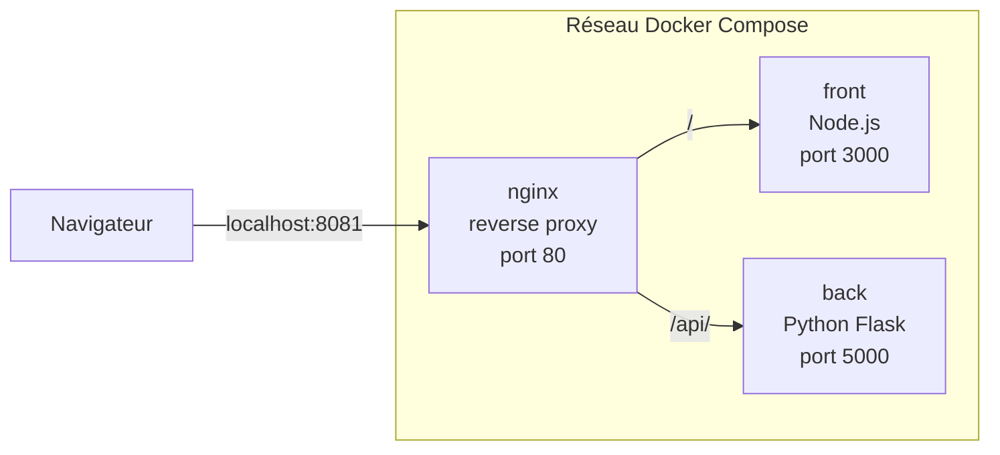

# Citation du jour

Application web qui affiche une citation au hasard, composée de trois conteneurs Docker orchestrés avec Docker Compose.

## Schéma



1. Le navigateur demande `localhost:8081` : nginx renvoie la page du front.
2. La page demande `/api/quote` : nginx transmet au back, qui renvoie une citation en JSON.
3. La page affiche la citation.

## Choix techniques

| Service | Techno | Justification |
|---|---|---|
| back | Python / Flask | Crée une petite API en quelques lignes. Image `slim` légère avec Python préinstallé. |
| front | Node.js | Très répandu pour le web. Image `alpine` légère, exécution avec un utilisateur non-root. |
| nginx | nginx | Porte d'entrée unique : redirige `/` vers le front et `/api/` vers le back. Léger et rapide. |
| orchestration | Docker Compose | Lance les trois services en une commande et les relie dans un même réseau. |

Bonnes pratiques appliquées :
- Dépendances copiées avant le code pour profiter du cache Docker.
- Seul nginx est exposé sur la machine : front et back ne sont joignables qu'à travers lui.
- Arrêt propre des applications (code de sortie 0) à la réception du signal `SIGTERM`.
- `HEALTHCHECK` sur le front pour vérifier qu'il répond.

## Lancer le projet

```bash
docker compose up --build
```

Puis ouvrir http://localhost:8081

Pour tout arrêter :

```bash
docker compose down
```