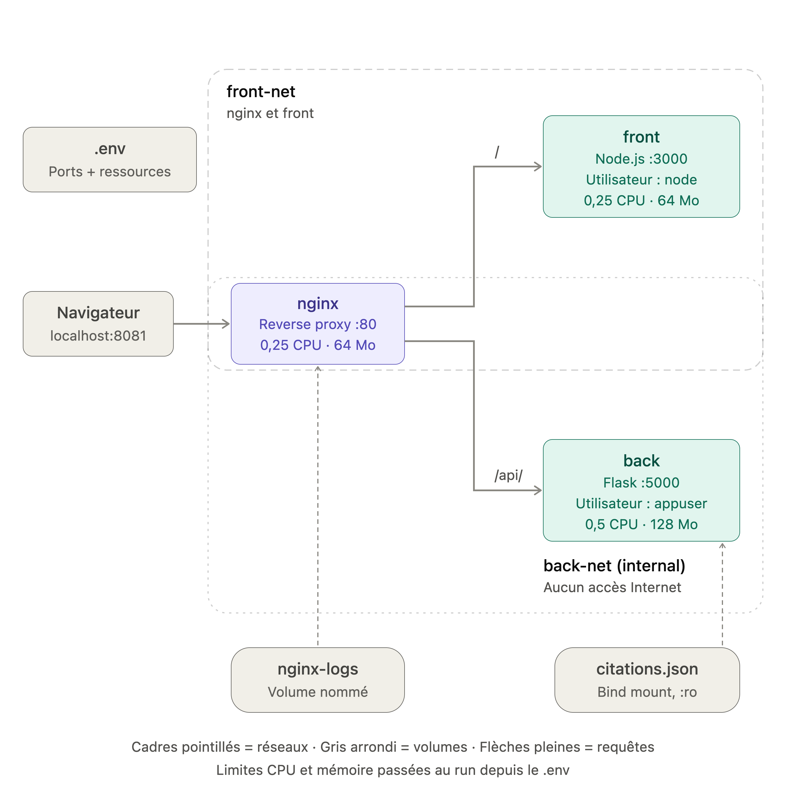

# Docker Cloud : Citation du jour

## Contexte

Ce projet simule la mise en place d'un **mini-cloud basé sur Docker** : une infrastructure où chaque service tourne dans son propre conteneur, avec ses ressources, son réseau et son stockage définis.

Pour démontrer cette infrastructure, elle héberge une application simple : **Citation du jour**, un site en français qui affiche une citation tirée au hasard. Le sujet autorise un "Hello World" ; nous avons choisi une application à peine plus riche pour montrer de vrais échanges entre services (le front demande une citation au back, en passant par le serveur web).

L'intérêt du projet n'est donc pas l'application elle-même, mais l'architecture qui l'héberge : images personnalisées, orchestration, isolation réseau, persistance des données et allocation des ressources.

## Démarrage rapide

Prérequis : Docker Desktop (ou Docker Engine avec le plugin Compose).

```bash
cd projet-final
cp .env.example .env
docker compose up -d --build
```

Puis ouvrir **http://localhost:8081**.

Pour tout arrêter :

```bash
docker compose down
```

## Vue d'ensemble

| Service | Rôle | Technologie | Accessible depuis la machine |
|---|---|---|---|
| nginx | Serveur web, point d'entrée unique (reverse proxy) | nginx (Alpine) | Oui, port 8081 |
| front | Sert la page affichée à l'utilisateur | Node.js 20 (Alpine) | Non, uniquement via nginx |
| back | API qui fournit les citations | Python 3.11 / Flask | Non, uniquement via nginx |



## Images : choix au build

Les trois images sont construites à partir de nos propres Dockerfiles (`build:` dans le compose). Aucune image n'est utilisée telle quelle : chacune part d'une image de base officielle, que nous personnalisons avec notre code, notre configuration et nos réglages.

### Image back (`back/Dockerfile`)

| Élément | Choix | Justification |
|---|---|---|
| Image de base | `python:3.11-slim` | Python préinstallé, variante Debian allégée (~150 Mo). Plus compatible qu'Alpine pour les bibliothèques Python. |
| Dépendance | Flask (`requirements.txt`) | Micro-framework web : une API en quelques lignes. Seule dépendance du projet. |
| Installation | `pip install --no-cache-dir -r requirements.txt` | `--no-cache-dir` ne conserve pas les fichiers téléchargés : image plus légère. |
| Ordre des couches | `requirements.txt` copié et installé **avant** le code | Si seul le code change, la couche d'installation reste en cache : rebuilds beaucoup plus rapides. |
| Fichiers copiés | `app.py`, `citations.json` | Le code de l'API et une version par défaut des citations. |
| Opération sur l'OS | `RUN useradd --system --no-create-home appuser` | Crée un compte de service sans mot de passe ni dossier personnel. |
| Utilisateur | `USER appuser` | Sécurité : l'API ne tourne pas en root. Placé après `pip install`, qui a besoin des droits root pour installer Flask. |
| Variable | `ENV PORT=5000` | Port par défaut lu par `app.py`, surchargé au run par le compose. |
| Port | `EXPOSE 5000` | Documente le port d'écoute. N'ouvre rien sur la machine. |
| Démarrage | `CMD ["python", "app.py"]` | Forme exec : Python est le processus principal (PID 1) et reçoit directement le signal d'arrêt. |

**Personnalisation du code :** `app.py` intercepte le signal `SIGTERM` envoyé par `docker stop` et quitte avec le code 0. Sans cela, Python ignorait le signal et Docker forçait l'arrêt après 10 secondes (code 137).

### Image front (`front/Dockerfile`)

| Élément | Choix | Justification |
|---|---|---|
| Image de base | `node:20-alpine` | Node.js préinstallé sur Alpine Linux : la variante la plus légère (~190 Mo contre ~1 Go pour l'image complète) et la plus petite surface d'attaque. Le front n'utilise aucun module natif, donc la libc d'Alpine (musl) ne pose pas de problème. |
| Opération sur l'OS | `RUN chown -R node:node /app` | Donne le dossier de l'application à l'utilisateur `node` (fourni par l'image). Fait avant `USER`, car seul root peut changer un propriétaire. |
| Utilisateur | `USER node` | Sécurité : l'application ne tourne pas en root. En cas de faille, l'attaquant n'aurait pas les droits d'administration du conteneur. |
| Dépendances | `package.json` et `package-lock.json` copiés avant le code | Même logique de cache que pour le back. |
| Installation | `npm ci` | Installe exactement les versions du `package-lock.json` : builds reproductibles. Aucune dépendance externe pour l'instant (serveur basé sur le module `http` intégré à Node). |
| Copie | `COPY --chown=node:node` | Sans `--chown`, les fichiers copiés appartiendraient à root malgré `USER node`. |
| Exclusions | `.dockerignore` (`node_modules`, `.git`, logs) | Ces fichiers ne sont pas envoyés au build : build plus rapide, image plus propre. |
| Variables | `NODE_ENV=production`, `PORT=3000` | Mode production pour Node, port par défaut surchargé au run. |
| Port | `EXPOSE 3000` | Documente le port d'écoute. |
| Santé | `HEALTHCHECK` toutes les 30 s sur `/health` | Docker vérifie que l'application répond ; le conteneur passe `unhealthy` après 3 échecs. Le port est lu dans `PORT`, il suit donc la configuration. |
| Démarrage | `CMD ["node", "server.js"]` | Forme exec, pour la même raison que le back. |

**Personnalisation du code :** `server.js` sert la page `index.html`, expose `/health` pour le healthcheck, et s'arrête proprement sur `SIGTERM`.

### Image serveur web (`nginx/Dockerfile`)

| Élément | Choix | Justification |
|---|---|---|
| Image de base | `nginx:alpine` | Serveur web léger et performant, très utilisé en production. Pas de `CMD` à écrire : l'image démarre déjà nginx. |
| Configuration | `default.conf.template` copié dans `/etc/nginx/templates/` | Au démarrage, nginx remplace `${FRONT_PORT}` et `${BACK_PORT}` par leurs valeurs et génère sa configuration. Les ports ne sont donc écrits qu'à un seul endroit : le `.env`. |
| Routage | `/` vers le front, `/api/` vers le back | nginx est le seul point d'entrée. Le `/` final de `proxy_pass` retire le préfixe `/api` avant de transmettre au back. |
| Logs | `citation-access.log` et `citation-error.log` | L'image officielle redirige ses logs par défaut vers la console. Nous écrivons dans de vrais fichiers pour les conserver dans un volume. |
| Port | `EXPOSE 80` | Port d'écoute de nginx dans le conteneur. |

## Arguments du run (docker-compose.yml et .env)

Tous les réglages du run sont centralisés dans le fichier `.env`, lu automatiquement par Docker Compose. Pour modifier un port ou les ressources d'un service, on change une ligne du `.env` puis on relance `docker compose up -d` : aucun rebuild n'est nécessaire.

Le fichier `.env` n'est pas versionné (il est dans le `.gitignore`, car dans un vrai projet il contiendrait des secrets). Le fichier `.env.example`, versionné, sert de modèle.

### Variables du `.env`

| Variable | Valeur | Rôle |
|---|---|---|
| `COMPOSE_PROJECT_NAME` | `citation-du-jour` | Préfixe des conteneurs, réseaux et volumes |
| `NGINX_PORT` | `8081` | Port d'accès depuis la machine (seul port ouvert) |
| `FRONT_PORT` | `3000` | Port d'écoute du front dans le réseau Docker |
| `BACK_PORT` | `5000` | Port d'écoute du back dans le réseau Docker |
| `BACK_CPUS` / `BACK_MEMORY` | `0.5` / `128M` | Ressources du back |
| `FRONT_CPUS` / `FRONT_MEMORY` | `0.25` / `64M` | Ressources du front |
| `NGINX_CPUS` / `NGINX_MEMORY` | `0.25` / `64M` | Ressources de nginx |

### Arguments par service

| Argument | back | front | nginx |
|---|---|---|---|
| `build` | `./back` | `./front` | `./nginx` |
| `environment` | `PORT=${BACK_PORT}` | `PORT=${FRONT_PORT}` | `FRONT_PORT`, `BACK_PORT` |
| `ports` | aucun | aucun | `${NGINX_PORT}:80` |
| `networks` | `back-net` | `front-net` | `front-net` et `back-net` |
| `volumes` | `./back/citations.json:/app/citations.json:ro` | aucun | `nginx-logs:/var/log/nginx` |
| `deploy.resources.limits` | `${BACK_CPUS}`, `${BACK_MEMORY}` | `${FRONT_CPUS}`, `${FRONT_MEMORY}` | `${NGINX_CPUS}`, `${NGINX_MEMORY}` |
| `depends_on` | aucun | aucun | `front`, `back` |

**`environment`** transmet des variables **à l'intérieur** du conteneur. Elles remplacent les valeurs par défaut des `ENV` des Dockerfiles. nginx reçoit les ports du front et du back pour générer sa configuration.

**`ports`** : seul nginx publie un port sur la machine. Le front et le back ne sont joignables qu'à travers lui : moins de portes ouvertes, et un point d'entrée unique.

**`depends_on`** démarre le front et le back avant nginx, qui redirige vers eux.

### Réseaux

| Réseau | Membres | Particularité |
|---|---|---|
| `front-net` | nginx, front | Réseau standard |
| `back-net` | nginx, back | `internal: true` : aucun accès à Internet |

nginx est le seul conteneur présent dans les deux réseaux : c'est l'unique pont entre le front et le back. Vérifications effectuées :

- nginx joint le back : `docker compose exec nginx wget -qO- http://back:5000/quote` renvoie une citation.
- Le front ne peut pas joindre le back : la même commande depuis le front renvoie `bad address 'back:5000'`.
- Le back n'a pas accès à Internet : une requête vers google.com échoue (`Temporary failure in name resolution`).

### Volumes

| Volume | Type | Rôle |
|---|---|---|
| `./back/citations.json` | Bind mount (fichier de la machine), lecture seule `:ro` | Les citations se modifient sans rebuild ni redémarrage. Le conteneur peut les lire mais pas les modifier. |
| `nginx-logs` | Volume nommé (géré par Docker) | Les logs de nginx survivent à la suppression du conteneur (`docker compose down`). Seul `docker compose down -v` les supprime. |

## Allocation des ressources et benchmarks

### Méthode

1. Mesure de la consommation au repos avec `docker stats --no-stream`.
2. Test de charge **sans limites** avec ApacheBench : 20 000 requêtes sur l'API, 50 simultanées.
3. Choix des limites à partir des mesures.
4. Même test de charge **avec limites**, pour comparer.

Commande de test :

```bash
ab -l -n 20000 -c 50 http://127.0.0.1:8081/api/quote
```

L'option `-l` accepte des réponses de longueurs différentes : sans elle, ApacheBench compte à tort comme « échecs » les citations dont la taille diffère de la première.

### Mesures de consommation

| Service | Mémoire au repos | Mémoire sous charge |
|---|---|---|
| back | 22 Mo | 57 Mo |
| front | 9 Mo | 9 Mo |
| nginx | 8 Mo | 9 Mo |

### Limites choisies

Environ deux fois le pic de mémoire mesuré, pour garder une marge :

| Service | CPU | Mémoire | Raison |
|---|---|---|---|
| back | 0,5 | 128 Mo | Service le plus sollicité : chaque requête API est traitée par Python. |
| front | 0,25 | 64 Mo | Sert une seule page statique, très peu sollicité. |
| nginx | 0,25 | 64 Mo | Ne fait que transmettre les requêtes, très léger. |

### Résultats

| Mesure | Sans limites | Avec limites |
|---|---|---|
| Requêtes par seconde | 1497 | 400 |
| Temps moyen par requête | 33 ms | 125 ms |
| Requêtes en échec | 0 | 0 |

### Analyse

- **Aucune erreur avec les limites** : la mémoire allouée est suffisante, aucun conteneur n'a été arrêté pour dépassement de mémoire.
- **Débit divisé par environ 3,7** : le CPU est le facteur limitant de l'application, pas la mémoire. Une limite CPU ralentit un conteneur sans le tuer, alors qu'un dépassement de mémoire l'arrête (code 137).
- **Conclusion** : 400 requêtes par seconde suffisent largement pour ce service, et les limites protègent la machine si un conteneur s'emballe. Si le besoin augmentait, c'est le CPU du back qu'il faudrait augmenter en priorité (`BACK_CPUS` dans le `.env`).

## Vérifier le fonctionnement

Après `docker compose up -d --build`, depuis le dossier `projet-final` :

| Vérification | Commande | Résultat attendu |
|---|---|---|
| Conteneurs démarrés | `docker compose ps` | 3 services `running`, le front `(healthy)` après ~30 s |
| Application | ouvrir http://localhost:8081 | Une citation s'affiche, elle change à chaque rechargement |
| API via nginx | `curl http://localhost:8081/api/quote` | Une citation au format JSON |
| Front et back non exposés | `curl http://localhost:3000` | Connexion refusée |
| Back sans root | `docker compose exec back whoami` | `appuser` |
| Limites de ressources | `docker stats --no-stream` | Colonne LIMIT : 128MiB (back), 64MiB (front, nginx) |
| Isolation réseau | `docker compose exec front wget -qO- http://back:5000/quote` | `bad address 'back:5000'` |
| Back sans Internet | `docker compose exec back python -c "import urllib.request; urllib.request.urlopen('https://www.google.com', timeout=3)"` | Erreur de résolution de nom |
| Logs persistants | `docker compose exec nginx tail -n 3 /var/log/nginx/citation-access.log` | Les dernières visites, conservées après `down` puis `up` |
| Arrêt propre | `docker compose down` | Arrêt en moins d'une seconde, sans attente de 10 s |

## Limites et pistes d'amélioration

- **Serveur de développement Flask** : suffisant pour ce projet, mais en production on utiliserait un serveur WSGI comme Gunicorn, capable de traiter plusieurs requêtes en parallèle.
- **Healthcheck** : seul le front en possède un. En ajouter au back et à nginx permettrait d'utiliser `depends_on` avec `condition: service_healthy`, pour que nginx ne démarre qu'une fois les autres services réellement prêts.
- **Passage à l'échelle** : avec Docker Swarm, on pourrait lancer plusieurs répliques du back derrière nginx et les répartir sur plusieurs machines.